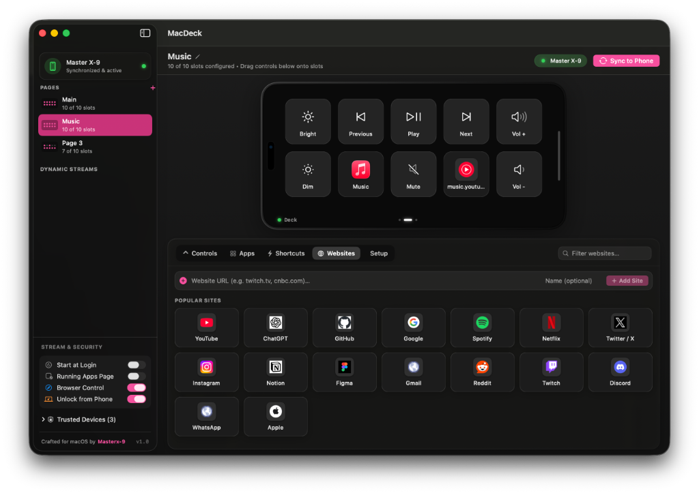

# MacDeck

MacDeck turns your Android phone into a control deck for your Mac. Build a page on your computer, lay your phone beside your keyboard, and tap a tile to do something on the desktop. A writing deck might hold your notes app, a reference site, and a music control. A recording deck on the Mac can put your OBS scenes and microphone under your fingertips.

MacDeck is my favorite project I’ve built. If you’re trying it for the first time, start with one button for something you do every day. That’s enough to make the deck feel like yours. — Jatin

## Download and install

> [!CAUTION]
> MacDeck is made for **macOS and Android**. The Windows host (WinDeck) is still in development and has not been tested. This release provides the Mac host and Android companion.

| Device | Download | Install |
| --- | --- | --- |
| Mac | [Download MacDeck.dmg](https://github.com/master-x9/macDeckk/releases/download/mac-android/MacDeck.dmg) | Open the disk image, copy MacDeck to Applications, and launch it. Allow local network access if prompted. |
| Android phone | [Download MacDeck.apk](https://github.com/master-x9/macDeckk/releases/download/mac-android/MacDeck.apk) | Open the APK from Downloads and tap **Install**. If Android prompts you, allow installation from the app that opened the file. You can switch that permission off afterward. |

Install both files, then follow [Pair your phone and try a tile](#pair-your-phone-and-try-a-tile). You can also find both installers on the [GitHub release page](https://github.com/master-x9/macDeckk/releases/tag/mac-android).

## What can go on a deck?

| On your phone | On your computer |
| --- | --- |
| An app or website tile | Open an application or jump straight to a saved URL. Put the tools for one task together on a named page. |
| Media and system controls | Pause music, skip a track, change volume, take a screenshot, or keep the computer awake. |
| Browser controls | Move between tabs, go back or forward, refresh, or open a new tab while the browser is active. |
| A running-apps page | See which apps are open and tap one to bring it forward. The page updates as the set of running apps changes. |

The **macOS host** also supports app-triggered pages. For example, you can have your recording deck appear when OBS comes to the foreground. Its OBS integration builds tiles from your scene list and adds recording, streaming, replay buffer, and microphone controls. The Discord integration lets you pin channels your configured bot can access.

## Pair your phone and try a tile

1. Connect the phone and computer to the same local network. Leave MacDeck running on your Mac.
2. Open the mobile companion and select your computer by name. Check the device name in the desktop pairing prompt, then click **Allow** on your Mac.
3. In the desktop editor, select a page or click **+** to create one. Try naming it **Everyday**.
4. Add a **Volume Up** tile. Drag the volume control from the library onto an empty slot and click **Sync to Phone**.
5. Open **Everyday** on your phone and tap the tile. Your computer’s volume should increase. Add your most-used app to the next slot and try launching it the same way.

## Make a recording deck on macOS

In OBS, open **Tools → WebSocket Server Settings**, enable the server, and note its port and password. In MacDeck, open **Configure OBS & Discord… → OBS**, enter the matching connection details, and click **Save & Reconnect**. Enable **OBS Page** in the sidebar. Your scene names become tiles, so you can switch scenes from the phone while keeping the preview visible on your Mac.

## Troubleshooting

| What you see | What to check |
| --- | --- |
| The phone can’t find the computer | Keep the host running and check that both devices can reach each other on the LAN. Guest Wi-Fi can isolate devices. Discovery uses Bonjour/mDNS (`_macdeck._tcp`), and the host accepts connections on TCP port `62233`. |
| A pairing request stays pending | Bring the desktop host window forward. Pairing needs approval on the computer before the phone receives its pages. |
| Apps launch, but Mac media or keyboard tiles do nothing | Check MacDeck’s Accessibility permission in System Settings, then retry the tile. |
